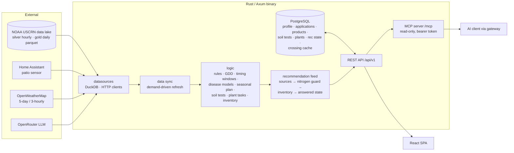

# High-Level Design: TurfOps

## Problem

Cool-season lawn care is a timing problem. Pre-emergent, seeding, fertilizer, grub control and fungicide each have a window that depends on soil temperature, accumulated heat, the freeze calendar and recent weather. Calendar-date rules of thumb miss those windows by weeks in either direction. Generic advice from extension sheets, product labels and lawn sites is not tied to the conditions at one particular yard. It also knows nothing about what has already been applied, so it can recommend a fungicide the lawn is already protected by, or a pre-emergent in a season that is being seeded.

A homeowner who wants to act on data has to pull together several things by hand: a weather station's soil probes, a forecast, a backyard sensor, their own application history and what is on the shelf. They then have to apply agronomic models they rarely have the time or training to run.

## Approach

TurfOps is a single-lawn web application. It joins measured local conditions with the owner's application log, runs published agronomic models over both, and turns the result into one consistent set of recommendations.

### Measured conditions, read in place

Conditions come from a nearby NOAA USCRN station (soil temperature and moisture at depth, air, humidity, rain). They are read from the owner's weather data lake, the bronze/silver/gold parquet files a separate pipeline maintains. The backyard Home Assistant sensor provides ambient readings, and OpenWeatherMap provides the 5-day outlook. The lake is read in place with embedded DuckDB. TurfOps never copies or caches raw weather. It caches only its own derived results, and only where recomputing them is expensive.

### Models, not heuristics

Each agronomic question has a named method:

- **Timing windows** (seeding, spring and fall pre-emergent) come from the station's own history of 5 cm soil-temperature crossings and freeze dates. Each historical year is dated separately, then summarized as a median and spread.
- **Disease risk** runs one published model per disease, with experimental ones flagged.
- **Seasonal rules** (grub control, nitrogen, broadleaf herbicide, irrigation, heat stress) are pure functions of conditions, growing degree days and the log.

Every method is written down in `docs/agronomy-methods.md` and `docs/timing-windows.md`, which are kept in sync with the code.

### One recommendation feed

Rules, timing windows, disease risk, landscape-plant tasks and application follow-ups all feed a single recommendation pipeline, in this order:

1. Each source produces its recommendations, marking any that ask the owner to apply nitrogen to the lawn as feedings.
2. A nitrogen guard holds marked feedings during active weather blocks and caps their nitrogen to the annual budget.
3. An inventory pass marks each recommendation on hand or need to buy, using the shelf.
4. The owner's past answers (addressed or dismissed, with escalation and expiry) are applied.
5. The feed is sorted by severity, most severe first.

The dashboard, the Recommendations page, the shopping list and the MCP server all read this same feed, in this same order.

Soil-test advice is not a feed source. It lives on the Soil Tests page and the MCP `soil_test_advice` tool. Lawns tested once every few years would otherwise have one aging test steering ongoing advice; it can join the feed, under the same nitrogen guard, once testing is regular.

### Application log as the memory of the lawn

What was applied, when, and from which shelf product drives protection windows, FRAC rotation, the nitrogen budget, the rule that seeding and pre-emergent never share a season, and task completion. The log is the source of these inferences. TurfOps does not ask the owner to keep separate settings in sync with it.

### Agent access through MCP

A read-only MCP server is built into the same binary. It exposes the REST handlers as tools, so an AI client gets exactly the answers the UI shows and can combine them with other servers behind the owner's gateway.

## Target Users

- **The lawn owner.** One homeowner managing a cool-season tall-fescue-type lawn (plus landscape plants) in USDA Zone 7a, near the USCRN station. They log every application, want to know what to do this week and why, and will read the methodology. They do not want to re-enter state the app could infer.
- **An AI agent acting for the owner.** Reaches TurfOps through the MCP gateway to answer questions and combine lawn state with other data. It needs model-readable, trimmed results and must not be able to change anything.

## Goals

- Every surface (dashboard, Timing, Disease Risk, Seasonal Plan, Calendar, Recommendations, shopping list, MCP) gives the same answer for the same day and lawn.
- Timing-window dates come from this station's measured record, and the spread between years is shown alongside the median.
- Disease advice says what is protected, what is not, and which FRAC class to use next without repeating the last one, all based on what was actually logged.
- Recommendations reflect the shelf: each says whether the product is on hand, and the shopping list lists only what active advice requires.
- When the app is idle, it makes no external calls. Data refreshes only when someone views it, within fixed staleness limits.
- Losing one data source (lake, Home Assistant, OpenWeatherMap, OpenRouter) degrades only the features that depend on it. Nothing else breaks.
- Every error the owner sees is plain language that says what went wrong and, where there is one, what to do about it. Raw status codes, JSON bodies, upstream response bodies and internal details never reach the screen; they stay in the log.

## Non-Goals

- **Multi-tenant or commercial use.** One lawn, one station, one owner, deployed on a home server. A commercial product is a separate codebase.
- **Label rates.** Advice never states a product's label rate, and never any rate for a pesticide (fungicide, herbicide, insect control). The label governs product use. Agronomic amounts are part of the advice: nutrient per 1,000 sq ft (the nitrogen budget is kept in lb N/1,000 sq ft), lime or sulfur from a soil test, seed per 1,000 sq ft, mulch depth. A nutrient or soil-correction amount may also be expressed as an amount of a specific fertilizer or soil-amendment material (pounds of a fertilizer from its analysis, Epsom salt for magnesium), but a material that is also a pesticide active (copper sulfate, for example) is given only as the nutrient amount. A label rate the owner records (optionally suggested by the LLM) pre-fills the application form; the MCP assistant may report it when the owner asks about that product, as the owner's recorded value with "verify against your label". It never appears in advice.
- **Quantity tracking.** Shelf stock is a hand-set In stock / Low / Out, with no amounts or usage math.
- **Warm-season lawns.** TurfOps serves cool-season lawns; `Mixed` is a cool-season blend. The profile accepts warm-season grasses, but no behavior for them is designed or supported, and whatever the code does for one is not intent.
- **Modeled weather as a substitute for the station.** Gridded or reanalysis products are not used for observed history or window dating.
- **Writes through MCP and in-app chat.** Agents read. The owner changes state through the UI.
- **LLM-generated agronomic advice.** The LLM writes landscape-plant care plans and product profiles only. Recommendations come from deterministic code.

## Tenets

*Ordered: when two conflict, the higher one wins.*

- **One answer everywhere.** When a new method covers ground an existing one covers, it replaces the old one rather than running beside it. Each answer comes from a single source that every surface reads.
- **Withhold rather than invent.** When the data cannot support a date, tier or alert, show none and say why. Do not fall back to a plausible estimate. (The calendar fallback for stale data is labeled as such.)
- **Measured over modeled.** Prefer the station's measured record, with its lag and gaps, over a gapless modeled source. Lag is disclosed rather than hidden.
- **Infer from the log, not from settings.** When a fact about the lawn can be read from the application log, derive it there instead of adding a toggle or field the owner must keep current.

## System Design

**Components** (each a node under `docs/intent/`; Weather data access and Disease risk are sub-HLDs over child leaves):

| Component | Responsibility |
|---|---|
| Weather data access | Reads the lake (live reading per sensor, daily aggregates, climate record), Home Assistant and the OWM forecast, with local-date bucketing. Owns the read-only environmental views: the Environmental page, `/historical`, and the 10 cm soil-temperature outlook. Children: weather sources, soil-temperature outlook, environmental views. |
| Data sync | Refreshes on demand when sensors are over 5 min stale or the forecast over 30 min. Keeps the last good values across failures. Reports connection status (`/health`). |
| Agronomic rules | Ten pure rule functions over the environmental summary, GDD and the log, the nitrogen guard, GDD accumulation, and the annual nitrogen budget. |
| Timing windows | Seeding and pre-emergent windows: boundary definitions, per-year crossings, climatology, resolving this season's state, recommendations and seasonal-plan activities. |
| Disease risk | Per-disease models, tiers, headline fallback, management programs, the FRAC efficacy matrix, protection windows and rotation. Children: risk models, management, disease UI. |
| Seasonal plan and calendar | Predicted activity windows from historical crossings, merged with timing-window activities. Calendar overlay of plan and log. |
| Recommendation feed and state | Gathers every source, runs the enrichment passes, and applies the answered-state policy (escalation and expiry). |
| Applications | The lawn profile and the log: types, FRAC classes, product links, the duplicate key, nitrogen accounting, follow-up reminders. |
| Product inventory | The shelf: categories, user-owned facts, LLM profile, product needs, enrichment, shopping list. |
| Soil tests | Recorded tests and pH, N-P-K and micronutrient advice, shown on the Soil Tests page and through MCP (not in the recommendation feed). |
| Landscape plants | LLM care plans, maintenance windows, watering hold-back. |
| MCP server | Tool router over the REST handlers, trimming, doctrine and methodology resources, bearer auth. |
| Web UI | Dashboard, the pages and their widgets, status palette and accessibility conventions. |
| Deployment | Multi-stage Docker image (distroless runtime), the environment configuration surface, and an example Compose file (app + PostgreSQL + lake mount) for anyone trying the project. The owner's own deployment is separate; nothing in the repo is tied to it. |

## Key Design Decisions

| Decision | Alternatives considered | Rationale |
|---|---|---|
| Read the weather lake in place with embedded DuckDB. | A weather HTTP API, a Postgres copy of the observations, the MCP gateway. | Parquet reads on a local mount are fast and always current. A copy goes stale and must be synced, and an API adds a service to run. Only derived, expensive results are cached (historical crossings in Postgres, the 15-year climate record memoized for 1 hour in memory). |
| Date timing windows per historical year, then summarize as median / p10 / p90. | One averaged climatological curve. | An averaged curve hides year-to-year spread and can cross a threshold on a date no real year did. Per-year dates give an honest range and allow years with sensor gaps to be dropped. |
| Use 5 cm soil temperature for timing windows. | 10 cm (available precomputed in the gold layer). | Germination of crabgrass and turf seed tracks the surface layer. 5 cm comes from aggregating the silver hourly data. |
| Keep each disease model on its own score, comparable only through the Low / Moderate / High / Severe tier. | One blended disease-pressure score. | The models measure different things (E-index, probability, criteria score). A blend would look precise without meaning anything. |
| Keep agronomic logic in pure functions with no I/O. | Rules that query the data they need. | Pure functions are testable against fixed inputs, run the same for every caller, and degrade cleanly when an input (such as GDD) is missing. |
| One recommendation feed with ordered enrichment passes. | Each page computing its own alerts. | It is the only way to guarantee every surface agrees. Answered state applies after enrichment so escalation compares against what the owner would see; the feed is sorted once, so every surface lists it in the same order. |
| Soil-test advice stays out of the feed. | Soil-test advice as a feed source. | The owner tests soil rarely. A single test, often years old, should not keep producing feeding and amendment alerts; the Soil Tests page shows its advice alongside its date. |
| Sources mark feedings; the nitrogen guard covers what is marked. | A fixed list of feeding ids in the guard. | One id can carry feeding and non-feeding advice (red thread says "feed" only while the lawn is nitrogen-hungry), and a new feeding source must not be able to escape the guard by having an id the guard does not know. |
| An answered recommendation returns when it escalates or its episode ends. | Permanent dismissal; recommendation ids that include the year. | Permanent dismissal hides a worsening risk. Episode expiry (weather 7 days, disease 21 days, seasonal 120 days) brings advice back when it is relevant again without rules having to encode years. |
| Seeding and pre-emergent are mutually exclusive per season, inferred from the log. | A per-season setting. | Pre-emergent kills new seedlings. The log already records which one happened. |
| No stock quantities. | Tracking amounts and deducting per application. | Hand-set In stock / Low / Out answers "do I need to buy this" without bookkeeping the owner will not keep up. |
| AI access through a read-only MCP server inside the app. | An in-app chat UI with a fixed context snapshot. | The AI client already provides the agent loop and UI. Pulling data through tools beats a fixed snapshot, and it combines with the owner's other MCP servers. Read-only limits the damage a wrong call can do. |
| The LLM supplies product facts and plant care plans, with curated data taking precedence. | LLM-authored recommendations. | Advice must be reproducible and match the documented methods. The curated FRAC resolver beats the LLM's FRAC list, and the owner's edits beat both. |
| Agronomic amounts in advice, never label rates. | No amounts at all; showing typical label rates. | Nutrient, lime and seed amounts are agronomy and do not depend on the product: the nitrogen budget and soil-test corrections cannot be expressed without them. How much of a product to apply is set by its label, which is the legal authority, above all for pesticides. Converting a nutrient amount into an amount of a fertilizer or amendment material is still agronomy; for a material that is also a pesticide active, the label governs, so only the nutrient amount is given. |
| "Today" and every date gate use the server's local date (`TZ`, set to the lawn's timezone). | The UTC date; a station-local date derived from the lake's UTC offset; the viewer's browser date. | Lake timestamps are UTC, but every agronomic date (a window's day, a freeze night, a residual window, a year boundary) is a lawn-local calendar day. One configured clock gives every component the same day, and observed data is bucketed into those same local days. Observed lake data keeps the lake's own day key, `obs_date_local`: the station's civil date in America/New_York, daylight-saving aware, which is the calendar `TZ` gives for this lawn, so the lake is never re-bucketed. |

## Success Metrics

- **Agreement.** For any day, the dashboard, Timing, Disease Risk, Seasonal Plan, Recommendations and MCP `lawn_snapshot` show the same state for the same window or disease. *Falsified by* any surface disagreeing with another.
- **Reproducibility.** Typical timing-window dates match an independent SQL reproduction over the same lake data. *Falsified by* a mismatch not explained by documented gap filtering.
- **No invented answers.** No recommendation carries a date, tier or rate the data does not support. *Falsified by* an overdue boundary showing a date, or any advice text stating a product label rate or a pesticide rate.
- **Idle cost.** Zero external calls while nobody is viewing. *Falsified by* scheduled polling appearing in the logs.
- **Graceful degradation.** Taking down any one data source removes only the features that depend on it. *Falsified by* a lake outage blanking unrelated pages or a forecast failure erasing observed data.
- **Test gate.** The backend test suite, clippy, the TypeScript build and the Biome lint all pass before merge.

## References

- `docs/agronomy-methods.md`: thresholds and models, kept in sync with code (also served as an MCP resource).
- `docs/timing-windows.md`: full timing-window method and deliberate differences from lawn-answers.com.
- `docs/plans/`: feature plans (product inventory, AI assistant / MCP, Open-Meteo forecast, USCRN soil dropout investigation).
- NOAA U.S. Climate Reference Network, station PA Avondale (WBANNO 3761).
- University of Kentucky PPA-1, *Chemical Control of Turfgrass Diseases* (2024): source of the FRAC efficacy ratings.
- Smith-Kerns dollar spot model; Fidanza brown patch E-index; Nutter Pythium criteria.
- lawn-answers.com Turf Tools: reference for the seeding, pre-emergent and disease tools.
