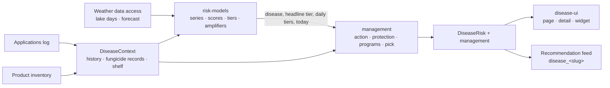

# High-Level Design: Disease Risk

## Problem

Five fungal diseases threaten a cool-season lawn in Zone 7a: brown patch, dollar spot, Pythium blight, gray leaf spot and red thread. Each is favored by a different mix of heat, humidity, night temperatures and leaf wetness, and the weather that matters is the last few days plus the next few. A homeowner who sprays on a calendar wastes fungicide and builds resistance. One who waits for symptoms is late, and Pythium can take seedling turf within days. Generic advice also ignores what was already sprayed. It can call for a fungicide while the lawn is still protected, or suggest the class that was just used.

## Approach

Disease Risk answers three questions for each disease, based on what was actually logged: **what is protected, what is not, and which FRAC class to use next.** This serves the HLD goal *"Disease advice says what is protected, what is not, and which FRAC class to use next without repeating the last one."*

It is built in two stages joined by one value, the **tier**:

1. **Risk models** turn a daily weather series (observed station days plus the forecast) into a native score and a Low / Moderate / High / Severe tier per disease, for the headline day and for each day of the past week and outlook. Lawn history can raise the headline tier one step.
2. **Management** turns a tier into an action and programs. It knows nothing about the weather except that day's tier and the tier of each displayed day. It reads the application log and the shelf to decide protection, rotation and the next class, and maps High/Severe to feed recommendations.

The Disease Risk page and dashboard widget render both stages. The feed receives the same computation.

Shared principles:

- **One published (or plainly labeled experimental) model per disease.** Native scores are never blended. Only the tier compares across diseases.
- **Pure functions.** Models, management and the recommendation mapping do no I/O. One API function gathers the lake, forecast, log and shelf.
- **Withhold rather than invent.** A day without enough of the right hours cannot be the headline. A product with no known FRAC class earns no protection.
- **Infer from the log.** Protection, rotation, seedling susceptibility and nitrogen status come from logged lawn applications. The owner never sets them.
- **The tier alone drives the action.** There is no symptom input. The curative program is always shown so the owner can act on what they see.
- **No pesticide rates.** Programs name classes, efficacy and intervals; the label governs how much. Nitrogen guidance in lb N per 1,000 sq ft is agronomy and is part of the advice.

TurfOps serves cool-season lawns; the five diseases are cool-season diseases, and warm-season lawns are unsupported (HLD Non-Goals).

## The Tier Contract

- **The headline tier** (`DiseaseRisk.tier`, after amplification) is the only tier management, the feed recommendation and the UI badge read. The daily tiers stay weather-only and are used for the outlook and the chart.
- **`today`** is defined once by risk-models, as the lawn's local date from the app's `Clock`, and passed to management. Every residual window, outlook day and rotation year is measured from it.
- **`DiseaseContext`** (`models/disease.rs`) is built once per computation from the lawn's log and the shelf. Risk-models reads its history fields (days since overseeding / fertilizer). Management reads its fungicide records, rotation warning, rotation streak flag and shelf.
- **One computation.** `api/disease_risk.rs` `compute` produces both the page response and the context the feed bridge uses, so the page, the widget and the feed agree by construction.

## Child Map

| Child | Prefix | Owns |
|---|---|---|
| [`risk-models/`](risk-models/risk-models-design.md) | `DIS-MODEL` | Daily series (lake + forecast join), usable-day rule, headline fallback, the five models and tier thresholds, history amplifiers, `data_notes`, `GET /disease-risk` assembly. `logic/disease/` except `management/` and `recommendations.rs`; `datasources/weather/disease.rs` query shape; `models/disease.rs`. |
| [`management/`](management/management-design.md) | `DIS-MGMT` | Action by tier, FRAC efficacy matrix, protection and residual windows, outlook heads-up, rotation, `recommended_class` with the shelf tiebreak, headline text, FRAC resolution of logged fungicides, the shelf in the context, feed recommendations and product needs, `GET /frac-classes`. `logic/disease/management/`, `logic/disease/recommendations.rs`, `models/disease_management.rs`, `models/frac_class*`. |
| [`disease-ui/`](disease-ui/disease-ui-design.md) | `DIS-UI` | `/disease-risk` and `/disease-risk/:slug`, `DiseaseDetail`, `ManagementPanel`, `DailyRiskChart`, `RiskMeter`, `TierBadge`, `DiseaseRiskWidget`, tier color + symbol + label, table views. `frontend/src/pages/DiseaseRisk.tsx`, `components/disease/*`, `types/disease.ts`. |

## Boundaries

| Component | Contract |
|---|---|
| **Weather data access** | `WeatherLakeClient::fetch_daily_disease_inputs(start)` returns per-day silver aggregates keyed by the lake's `obs_date_local`. The OWM 3-hourly forecast arrives on the environmental summary. `today` comes from the app's `Clock` (`TZ`). |
| **Data sync** | `compute` calls `sync_service.get_or_refresh()` for the forecast and the lake client. Disease Risk adds no staleness rules of its own. |
| **Applications** | Disease Risk reads the lawn's log for the last 365 days and owns the *meaning* of a logged fungicide (`classes_of`, protection, rotation). Applications owns the form's FRAC field and picker, which read `GET /frac-classes`. |
| **Product inventory** | Usable shelf fungicides fill `DiseaseContext.shelf`. Each disease recommendation declares a `ProductNeed`; inventory's `enrich` sets on-hand status later. |
| **Recommendation feed** | `api::disease_risk::recommendations()` is appended after the rules. Ids are `disease_<slug>`. The feed owns the answered-state policy (21-day disease episode) and the nitrogen guard's placement. |
| **MCP server** | Calls `get_disease_risk` directly and trims the result. |
| **Web UI** | Owns the shell, routing, API client and status palette. Disease Risk owns its pages and widget. |

## Key Design Decisions

| Decision | Alternatives considered | Rationale |
|---|---|---|
| Native score per model; only the tier compares across diseases. | One blended disease-pressure score. | The models measure different things (E-index, probability, criteria score). A blend would look precise without meaning anything (HLD). |
| The headline tier is the contract from models to management. Management sees tiers, never weather. | Management reading raw weather or scores. | [inferred] It keeps each model swappable and keeps management's rules (action, residual shortening, `protects_at_severe`) in one vocabulary shared by every disease. |
| Feed recommendations come from the same computation as the page. | Separate heuristic disease rules beside the models. | One answer everywhere. Two systems would let the dashboard disagree with the Disease Risk page. |
| No symptom input; the curative program is always shown; the tier alone drives the action. | An "I see symptoms" toggle. | Seeing symptoms is the owner's call, not an input the models can check; a toggle would be one more setting to keep current. The owner reads the curative program and applies it on their own judgment. |
| The amplified headline tier is what every consumer reads. | Amplifying only the displayed badge, or only the feed. | [inferred] The page, the management action and the feed must state the same tier for the same disease. |

## References

- `docs/high-level-design.md`: goals, tenets, the native-score decision, the rates non-goal, the server-local "today" decision
- `docs/agronomy-methods.md` § Disease risk: owner-facing method, kept in sync with the children's thresholds (also an MCP resource)
- Children: `risk-models/`, `management/`, `disease-ui/`
- Sibling components: weather-data (WX), data-sync (SYNC), applications (APP), product-inventory (INV), recommendation-feed (FEED), mcp-server (MCP), web-ui (UI)
