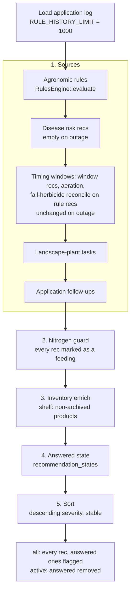

# Recommendation Feed & Answered State

## Context and Design Philosophy

Every piece of advice TurfOps gives is a `Recommendation`, and every surface that shows advice reads it from one pipeline: `backend/src/api/recommendation_feed.rs`. The dashboard's Active Alerts, the Recommendations page, the shopping list (`api/inventory.rs`) and the MCP `recommendations` / `lawn_snapshot` tools (`mcp/tools/lawn.rs`) all call `recommendation_feed::active` or `::all`. The HLD's first tenet, *one answer everywhere*, depends on this. A surface never filters, re-scores, re-words or reorders the feed. It can only truncate it.

The feed owns four things:

1. **The shape of a recommendation** (`models/recommendation.rs`): id, category, severity, text, data points, product needs and the feeding mark.
2. **The order of the pipeline**: every source, then the nitrogen guard, then the shelf, then the owner's answers, then one sort by severity. That order keeps ids and severities fixed by the time answers are applied, and gives every surface the same order.
3. **The answered-state policy** (`models/recommendation_state.rs`): what "Mark Addressed" and "Dismiss" mean and how long they last.
4. **The surfaces that list the feed**: the Recommendations page, the dashboard's Active Alerts (`AlertCard`), and the dashboard's layout as a composition of widgets that other components own.

The feed does not produce advice. Agronomic rules, timing windows, disease risk, landscape plants and application follow-ups each own their recommendations: when they fire, at what severity, with which id and which text, and whether a recommendation is a feeding. Soil-test advice is not a feed source (HLD); it stays on the Soil Tests page and the MCP `soil_test_advice` tool. Agronomic rules own the nitrogen guard's logic (`logic/rules/nitrogen_guard.rs`); the feed owns where it runs. Product inventory owns the enrichment pass and `InventoryBadge`.

The answered state follows one principle. A click answers *this alert at this severity for this episode*. It does not silence the rule for good. A dismissal never hides a risk that has worsened, and no source has to put a year or episode number in its id to make an answer expire.

## The Recommendation Contract

`Recommendation` (`models/recommendation.rs`), serialized as JSON to the SPA and MCP. Mirrored in `frontend/src/types/index.ts`.

| Field | Type | Owner | Notes |
|---|---|---|---|
| `id` | string | source | Stable identity across evaluations; the key of the answered state. |
| `category` | `RecommendationCategory` | source | Serialized as the variant name; the UI splits camel case (`categoryLabel`). Also drives episode class (below). |
| `severity` | `Info < Advisory < Warning < Critical` | source (+ nitrogen guard) | Derived `Ord` in declaration order; escalation compares with it. |
| `title`, `description`, `explanation` | string | source | `explanation` defaults to empty. |
| `data_points` | `[{label, value, source}]` | source, then inventory | Inventory appends "On hand" / "Not on shelf" points. |
| `suggested_action` | string? | source | |
| `needs` | `[ProductNeed]` | source (`with_need`) | Empty means nothing to fetch. Always serialized. |
| `inventory` | `InventoryStatus?` | product inventory | Omitted from the JSON when absent. |
| `feeding` | `Feeding { n_lbs_per_ksqft }?` | source (`with_feeding`), then nitrogen guard | The feeding mark: set when the advice is to apply nitrogen to the lawn now, carrying the suggested lb N/1000 sq ft. The guard acts on exactly these and lowers the amount when it caps one. Internal to the feed: never serialized (`#[serde(skip)]`) and absent from the TypeScript type. |
| `created_at` | timestamp | feed | Stamped at construction (`Utc::now()`), so it marks the evaluation time, not when the advice first appeared. |
| `dismissed`, `addressed` | bool | feed | Set only by the answered-state pass. `is_active()` is `!dismissed && !addressed`. |

Recommendations are built with `Recommendation::new(id, category, severity, title, description)` followed by `with_explanation`, `with_data_point`, `with_action`, `with_need` and `with_feeding`. A source declares what its action calls for with `with_need(ProductNeed)`; product inventory decides how the shelf answers it. A source marks a feeding with `with_feeding(n)`; agronomic rules decide what the guard does with it.

### Severity

| Severity | UI symbol | UI color | Typical meaning |
|---|---|---|---|
| Info | ℹ | gray | Heads-up, on hold, or protected |
| Advisory | → | blue | Worth doing now |
| Warning | ⚠ | amber | Act soon, closing or high risk |
| Critical | ! | red | Severe risk |

Colors and symbols live in `frontend/src/types/index.ts` (`SEVERITY_COLORS`, `SEVERITY_SYMBOLS`) and always appear together with the severity label, as ink text on a tint of the status color, the convention every status display uses. Today the badges are white text on a filled color (FEED-REC-004).

### Id conventions

Ids are owned by the sources. The feed depends on these properties:

- **An id is stable across evaluations for as long as it is the same advice.** Answered state is keyed by id alone.
- **Distinct stages of a progression use distinct ids** when the answer should not carry over. For example, `spring_n_too_early`, `spring_n_wait`, `spring_n_almost`, `spring_n_ready` and `spring_n_may_cutoff` are separate ids.
- **One id names one thing in the feed.** Nothing in the pipeline de-duplicates ids, and the UI uses the id as a React key.

| Pattern | Source | Episode class |
|---|---|---|
| `fertilizer_block` | agronomic rules | weather (special-cased by id) |
| `irrigation_forecast`, `heat_stress_forecast`, `rain_delay`, `application_window`, `mowing_height` | agronomic rules | weather (by category) |
| `fall_fert_*`, `spring_n_*`, `broadleaf_spring`, `broadleaf_fall`, `grub_control[_late]_<year>` | agronomic rules | seasonal |
| `disease_<slug>` | disease risk | disease |
| `timing_<window>_<season_year>`, `aeration` | timing windows | seasonal |
| `plant_<plant id>_<task idx>_<year>` | landscape plants | seasonal |
| `application_followup_<application id>` | applications | never expires |

## Pipeline

`recommendation_feed::all(state, profile, summary)` builds the feed in five stages, in a fixed order: every source, the nitrogen guard, the inventory pass, the answered state, the sort. `all` does the I/O: it reads the log, gathers the sources, loads the shelf and the answered rows, then hands everything to the pure `assemble(recs, &Stages { profile, history, today, products, answers, now })`, which runs stages 2–5 and is unit-tested without a database. `active` is `all` with answered items removed.

### Ordering invariants

1. **Timing runs after the rules.** `timing::companions::reconcile_fall_herbicide` edits or drops the rule-produced `broadleaf_fall`, so the timing pass must see the finished rule set (`api/timing.rs` `apply_to_feed`).
2. **The nitrogen guard runs after every source.** It covers every recommendation its source has marked as a feeding: one that asks the owner to apply nitrogen to the lawn now. The sources own the mark: the rules mark `fall_fert_*` and `spring_n_ready`; disease management marks `disease_red_thread` only while its advice is to feed. Landscape-plant Fertilizing tasks (plants are outside the lawn nitrogen budget) and `spring_n_may_cutoff` (a warning against feeding) are never marked. The guard reads the blockers (`fertilizer_block`, a Warning-or-higher `heat_stress_forecast`) from the assembled feed. Under a blocker it holds the whole recommendation (lowered to Info and retitled). Against the annual budget it caps only the nitrogen part of the advice, and at "target reached" it clears the nitrogen need. It is the only author of the "N budget remaining" data point. No feeding advice reaches the owner beside "avoid fertilizer" or past the budget, wherever it came from. Agronomic rules own what the guard does; the feed owns where it runs.
3. **Inventory runs after the guard.** `logic::inventory::enrich` reads each rec's final `needs` (after the guard has cleared any at "target reached"), sets `inventory`, and appends data points. It never changes `id`, `severity`, `title` or `dismissed`/`addressed`.
4. **Answers apply last.** The escalation check compares the answered severity against the severity the owner would see now, after the nitrogen guard. A feeding rec answered while "on hold" (Info) comes back once the hold lifts and it returns to Advisory or Warning.
5. **The feed is sorted once, last.** A stable sort by descending severity, so ties keep source order. Every surface uses this order and none reorders it: the dashboard takes the first three active recommendations, the Recommendations page lists the feed as returned, and the shopping list and MCP tools relay it.

### Inputs and dates

- The application log is read once (`queries::get_applications_for_profile`, newest first, 1000 rows) and shared by every source. Mowing is an application, so a shorter history would push this season's treatments out of view within weeks.
- `today` is the lawn's local date from the app's `Clock` (`state.clock.today()`, resolved once from `TZ`, which deployment sets to the lawn's timezone), as the HLD requires. The feed uses it for plant tasks and follow-ups (`recommendation_feed.rs:54`) and passes it to the nitrogen guard for the budget year. Sources that compute their own date internally are held to the same clock by their own LLDs.
- The answered-state check uses `Utc::now()` only as an instant, to measure elapsed episode time against `updated_at`; it gates no calendar date.
- The shelf is `product_queries::list_products_for_profile(.., include_archived = false)`.

### Failure and degradation

| Failure | Effect |
|---|---|
| No lawn profile | 404 from the handler before the feed runs |
| Profile row without id | `InvalidData` → 400 |
| Environmental refresh error | Handler returns the error; no feed |
| Lake / forecast unavailable for disease | Disease recs omitted (warn log); rest of feed intact |
| Lake unavailable for timing | No timing recs, no aeration, `broadleaf_fall` left as the rule produced it |
| Application, plant, product or answered-state query fails | Whole feed fails (`?`) |
| A stored severity string doesn't parse | Treated as `None`: the answer can still expire but never escalates |

## Answered State

### Persistence

The table is `recommendation_states`. It is created in `db/migrations/20240101000003_recommendation_states.sql` and gains the `severity` column in `20260921000100_recommendation_state_severity.sql`.

| Column | Type | Meaning |
|---|---|---|
| `id` | TEXT PK | Recommendation id. One row per id; the app has one lawn. |
| `dismissed` | BOOLEAN | Owner clicked Dismiss |
| `addressed` | BOOLEAN | Owner clicked Mark Addressed |
| `severity` | TEXT NULL | Severity the rec showed when answered; NULL = unknown (escalation disabled) |
| `updated_at` | TIMESTAMPTZ | Time of the last answer; the start of the episode clock |

Queries are in `db/queries.rs`: `get_recommendation_states` (the whole table as a map), `upsert_recommendation_state` (`updated_at = NOW()` on every write) and `delete_recommendation_state`. Rows are never pruned. A row whose episode has expired, or whose source no longer emits that id, stays in the table and has no effect.

### Suppression rule

`RecommendationState::suppresses(rec, now)` decides whether a stored answer still hides a recommendation. It returns true only when all of these hold:

1. The row has `dismissed` or `addressed` set.
2. The rec has **not escalated**: there is no stored severity, or `rec.severity <= stored severity`. A drop in severity does not bring the rec back.
3. The **episode is still running**: `now - updated_at < episode_days(rec)`, or the rec has no expiry.

When the answer holds, the feed copies both flags onto the rec. Otherwise the rec stays active, and the row is left in the table untouched. Dismissed and Addressed follow the same policy. The only difference is the label shown in the answered list.

### Episode classes

`episode_days(rec)` is evaluated in this order:

| Order | Test | Episode | Reasoning |
|---|---|---|---|
| 1 | id starts with `application_followup_` | none (until escalation) | The id names one event |
| 2 | id is `fertilizer_block` | 7 days | Weather block, even though its category is Fertilizer |
| 3 | category is Irrigation, HeatStress, FrostWarning, Mowing or ApplicationTiming, or the rec is a landscape-plant Watering task | 7 days | A rain, heat or dry spell is over within a week |
| 4 | category is DiseasePressure | 21 days | A systemic fungicide's residual window |
| 5 | anything else | 120 days | Long enough to cover the window it was answered in, short enough to be gone by the same season next year |

These are the escalations the policy is built for:

- A timing window that was Info ("opening soon") becomes Warning ("closing").
- A disease rec that was Protected (Info) becomes Critical (Severe) once the residual lapses.
- A follow-up that was Advisory before its date becomes Warning once due.
- A feeding rec that was on hold (Info) becomes Advisory when the hold lifts.

## API Endpoints

| Method | Path | Request | Response |
|---|---|---|---|
| GET | `/api/v1/recommendations` | `?include_inactive=true` (default false) | `Recommendation[]`. Without the flag, `active` (answered removed). With it, `all`: answered recs included and flagged. Feed order (descending severity) in both cases. Refreshes environmental data if stale. |
| PATCH | `/api/v1/recommendations/:id` | `{dismissed?: bool, addressed?: bool, severity?: Severity}` | `{id, dismissed, addressed}` |
| GET | `/api/v1/dashboard` | — | `{profile, environmental, recommendations, recent_applications, connections}`. `recommendations` is the first three of `active`. |

PATCH semantics (`api/recommendations.rs`):

- A flag missing from the body keeps its stored value. A missing `severity` keeps the stored severity.
- If either flag is true, the row is upserted and `updated_at` is reset, which restarts the episode.
- If both flags are false, the row is deleted. This is **Restore**.
- The id is not checked against the feed. Any string is accepted, and an id the feed does not produce is stored and then ignored.

## Surfaces

### Recommendations page (`frontend/src/pages/Recommendations.tsx`)

- Fetches `getRecommendations(true)` once and splits the result client-side into active and answered.
- **Active list**, in feed order (descending severity, ties in source order), so the dashboard's three alerts are the top of this list.
- Each active card shows the severity badge (symbol + label), the category, an `InventoryBadge` when `inventory` is set, the title, the description, and the **Mark Addressed** and **Dismiss** buttons. Each click sends `PATCH {[action]: true, severity: rec.severity}` and then flags the rec locally without re-fetching.
- **Detail pane** (opens when a card is selected): title, severity and category, description, Explanation, a Data Points table, Suggested Action, and an Inventory section. The Inventory section lists each product match with its stock if not In stock, and each missing need with a link to `/inventory`.
- **"Show dismissed / addressed (n)"** toggle. It explains that these items still apply, that each one returns on its own if it becomes more severe or once its episode ends, and it lists each answered rec with a **Restore** button (`PATCH {dismissed: false, addressed: false}`).
- When nothing is active, the page shows "No active recommendations. Your lawn is looking good!"

### Dashboard (`frontend/src/pages/Dashboard.tsx`, `components/AlertCard.tsx`)

The dashboard is a composition. The feed owns only the Active Alerts column and the layout. In order:

1. A header with the profile name, grass type, zone and last-updated time.
2. A stale-soil banner when the summary's `soil_stale` flag is set (data sync owns the 72 h rule; today the dashboard compares `soil_observed_at` itself).
3. Connection dots for the weather lake, Home Assistant and OpenWeatherMap.
4. Four gauges: 10 cm soil temp (with 7-day average and trend), ambient temp (with 7-day average), humidity, and soil moisture (with 7-day precipitation).
5. A widget grid with GDD, Disease Risk, Timing, the compact Shopping List, Nitrogen Budget and the Soil Temp Forecast. Each is owned by its feature LLD.
6. **Active Alerts**, the top 3 `AlertCard`s, shown beside **Recent Applications** (5 rows: date, type, product).

- `AlertCard` is read-only: severity badge, category, `InventoryBadge`, title and description, with no answer buttons. The owner answers on the Recommendations page.
- The backend takes the first three of `active`, so the dashboard alerts are always the top of the Recommendations page.
- `/dashboard` is fetched in parallel with `/gdd`, `/nitrogen-budget`, `/soil-temp-forecast`, `/disease-risk` and `/timing-windows`. A widget whose first fetch fails is hidden; a widget whose re-poll fails keeps its last good data, marked stale (today it is hidden; FEED-UI-013). A failed dashboard fetch fails the page, or shows "Data may be stale" over the last data.
- The page polls every 30 s while the tab is visible, stops when it is hidden, and re-fetches when it becomes visible again. Each poll is a viewer-driven refresh in the sense of the HLD's idle-cost goal.

## Decisions & Alternatives

| Decision | Chosen | Alternatives Considered | Rationale |
|---|---|---|---|
| Single feed for every surface | `recommendation_feed::all/active` read by dashboard, page, shopping list and MCP | Each page computes its own alerts | It is the only way to guarantee every surface agrees; the dashboard's top 3 is a subset of the page by construction (HLD) |
| Answer semantics | Answer holds until the rec escalates past the answered severity or its episode ends | Permanent dismissal; ids that include the year | Owner decision: permanent dismissal hides a worsening risk; episode expiry brings advice back without rules encoding years |
| Expiry per episode class | Weather 7 d, disease 21 d, seasonal 120 d, follow-ups never | One global expiry; per-rule expiry declared by each source | Owner decision for the escalation + expiry model. The specific spans and classifying by category, with id overrides, keep the policy in one file `[inferred]` |
| Where the policy lives | `models/recommendation_state.rs`, consulted by the feed | Sources set their own suppression | No source has to know about answers, and a new source gets sensible expiry from its category `[inferred]` |
| Nitrogen guard placement | A feed stage after every source, before inventory, over every rec its source marked as a feeding | Inside the rules engine over rule recs only; each source guarding its own feeding advice; a fixed id list | Feeding advice from any source must be held during a fertilizer block or heat stress and capped to the annual budget; guarding once, over the assembled feed, means a new feeding source cannot escape it. A source's mark, not an id list, because one id can carry feeding and non-feeding advice (red thread). Running before inventory lets a "target reached" rec drop its need before the shelf is consulted |
| Where the feed is sorted | Once, as the last stage of the feed | Each surface sorts for itself; source order | Every surface, MCP included, lists advice in the same order, and the dashboard's three alerts are the top of the page by construction |
| Answers apply last | After nitrogen guard and inventory enrich | Apply answers before enrichment | Enrichment never changes ids or severities, so escalation compares against what the owner would see now (HLD) |
| "Today" | The lawn's local date from the app's `Clock` (`TZ` = lawn timezone) | UTC date; station-local date from the lake's UTC offset; browser date | One configured clock gives every component the same lawn-local day (HLD) |
| Rows without a stored severity | Expire only, never escalate | Treat as Info (escalate on anything); delete | Answers recorded without a severity can't be compared safely `[inferred]` |
| De-escalation | Keeps the answer | Re-show on any severity change | Only rising risk warrants interrupting the owner again `[inferred]` |
| Restore | Delete the row (PATCH both false) | A separate DELETE route; a third "restored" flag | Owner decision: "Show dismissed" list with Undo. The absence of a row is the cleanest "never answered" `[inferred]` |
| Re-answering | Upsert resets `updated_at` | Keep the first answer time | A fresh click starts a fresh episode `[inferred]` |
| Dismissed vs Addressed | Same suppression policy, different label | Addressed suppresses longer / feeds the log | The log is the memory of the lawn; "Addressed" is a note, not a log entry `[inferred]` |
| Dashboard alerts | First three of the active feed, read-only cards | Full list with actions on the dashboard | Keep the dashboard a glance; answering happens where the detail is `[inferred]` |
| Recommendations page order | The feed's order (descending severity, ties in source order) | Source order; a page-side sort | The most severe advice comes first, and the dashboard's top three are the first three on the page |
| PATCH response | Flags only, client updates locally | Return the re-evaluated rec | Avoids recomputing the whole feed on each click `[inferred]` |

## Open Questions & Future Decisions

### Resolved

1. ✅ Dismiss / Addressed use escalation + expiry, with a "Show dismissed" list and Undo (Restore). Disease episodes follow the fungicide residual window and seasonal answers are gone before the same season next year.
2. ✅ Rules do not encode years in ids for expiry purposes. The state policy handles episodes.
3. ✅ The nitrogen guard is a feed stage over every feeding recommendation, after every source and before inventory and answers (see Pipeline).
4. ✅ Soil-test advice is not a feed source (HLD); the Soil Tests page and MCP `soil_test_advice` are its surfaces. If it rejoins the feed, `soil_test_npk` is marked as a feeding only when it asks for nitrogen, and the guard caps only its nitrogen part (soil-tests LLD).
5. ✅ The feed's "today" is the lawn's local date from the app's `Clock` (`TZ`). A source that dates its own work on another clock diverges in that source's LLD, not here.

### Deferred

1. **No de-duplication of ids.** If two sources ever emit the same id, both appear, one answer hides both, and the React keys collide (`recommendation_feed.rs:46-68`; `Recommendations.tsx:101`, `:270`). This is unenforced.
2. **Divergence: episode class follows category, not intent** (FEED-STATE-010). A landscape-plant Watering task ("during dry spells") is PlantMaintenance, so its answer holds 120 d like seasonal work, not 7 d like weather (`models/recommendation_state.rs:32-48`). Intent: Watering tasks get the 7-day weather episode. `FrostWarning` has a weather episode but no producer. `Fungicide`, `SoilTempForecast` and `General` are variants no production source emits.
3. **PATCH accepts any id and any flag combination** (`api/recommendations.rs:53-79`). It accepts unknown ids, `dismissed` and `addressed` both true, and a missing `severity` on a first answer, which stores NULL and disables escalation for that row. There is no 404 and no validation.
4. **Answered rows are never pruned** (`db/queries.rs:316-375`). Expired rows, and rows for ids a source no longer emits (deleted applications or plants, past `timing_*_<year>`), accumulate.
5. **Answered list shows only what still fires.** An answered rec whose source stopped emitting it disappears from "Show dismissed" but keeps its row. If the source re-emits it within the episode, it stays hidden (`recommendation_feed.rs:112-121`). This is intended per episode, but not stated in the UI.
6. **"Profile missing ID" maps to 400** (`recommendation_feed.rs:39-41`) although the request is not at fault.
7. **Repeated computation per dashboard poll.** `/dashboard` computes the feed, which includes disease and timing. The page also fetches `/disease-risk`, `/timing-windows` and the shopping list, which recomputes the feed again. All of this runs every 30 s.
8. **Shopping list hidden with the widget grid.** `ShoppingListPanel` sits inside a grid that renders only when another widget has data (`pages/Dashboard.tsx:245-250`). If GDD, nitrogen, soil forecast, disease and timing all fail, the shopping list is hidden too.
9. **Data Points table React key** is `${label}-${source}` (`Recommendations.tsx:199`). Several "On hand" points from Inventory share a key.
10. **Size limits.** `pages/Recommendations.tsx` (396 lines) and `pages/Dashboard.tsx` (372) exceed the 300-line limit. `recommendation_feed::all` (~51 lines) and the `Recommendations` and `Dashboard` components exceed the 50-line function limit.
11. **`created_at` is the evaluation time**, so it cannot express how long advice has been standing.

## References

- `docs/high-level-design.md`: One recommendation feed; Key Design Decisions (feed, answered state)
- `backend/src/api/recommendation_feed.rs`, `backend/src/api/recommendations.rs`, `backend/src/api/dashboard.rs`
- `backend/src/models/recommendation.rs`, `backend/src/models/recommendation_state.rs` (unit tests cover escalation, each episode class, follow-ups, NULL severity, cleared rows)
- `backend/src/db/queries.rs` (recommendation state queries); `backend/src/db/migrations/20240101000003_recommendation_states.sql`, `20260921000100_recommendation_state_severity.sql`
- `backend/src/logic/rules/nitrogen_guard.rs` (guard logic, owned by agronomic rules; run by `assemble`)
- `backend/src/api/timing.rs` `apply_to_feed`; `backend/src/api/disease_risk.rs` `recommendations`; `backend/src/logic/inventory.rs` `enrich`
- Consumers: `backend/src/api/inventory.rs` (shopping list), `backend/src/mcp/tools/lawn.rs`
- `frontend/src/pages/Recommendations.tsx`, `frontend/src/components/AlertCard.tsx`, `frontend/src/pages/Dashboard.tsx`, `frontend/src/api/client.ts`, `frontend/src/types/index.ts`
- Sibling LLDs: agronomic-rules (RULE), timing-windows (TIME), disease-risk (DIS), soil-tests (SOIL), landscape-plants (PLANT), applications (APP), product-inventory (INV), mcp-server (MCP), web-ui (UI)
